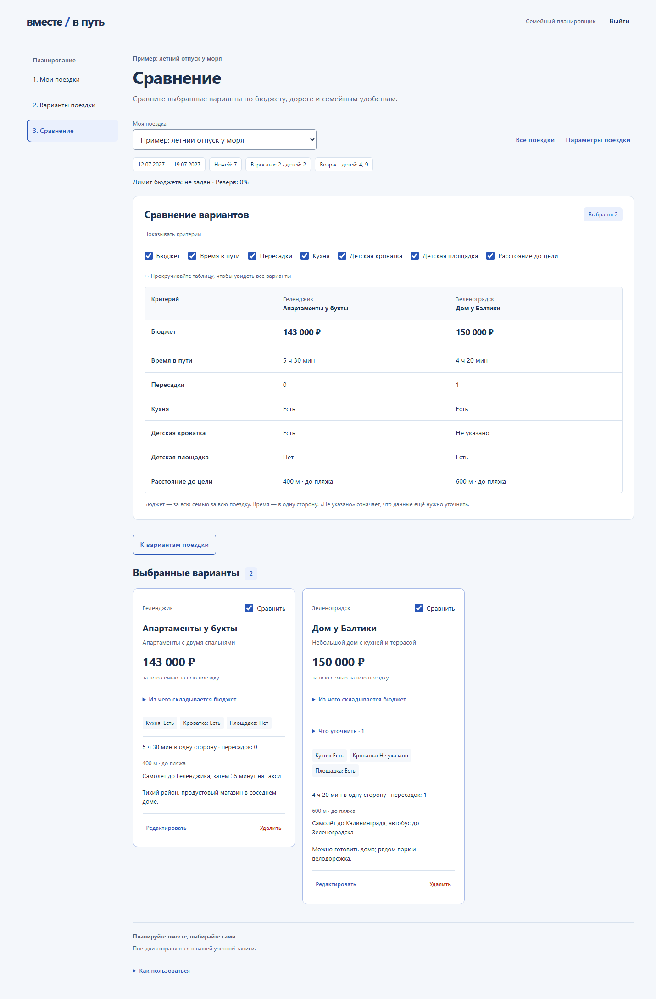

# Вместе в путь

«Вместе в путь» — приложение для планирования и сравнения семейных поездок.
Соберите варианты направлений и жилья, сравните расходы и выберите поездку,
которая подходит вашей семье и бюджету. Планы сохраняются в вашей учётной записи.

**[Открыть приложение](https://together.2-26-49-210.sslip.io/)**

## Возможности

- Несколько поездок с датами, составом семьи и возрастом детей.
- Варианты направлений и жилья с расходами, заметками и ссылками на предложения.
- Бюджет по шести статьям, лимит и резерв с показом остатка или превышения.
- Подсказки по недостающим сведениям; неизвестные расходы отличаются от нулевых.
- Сравнение двух и более вариантов по семи переключаемым критериям.
- Регистрация и вход по email и паролю или через Яндекс ID.
- Сохранение данных в учётной записи и защита черновика при ошибках сохранения.
- Добровольный импорт из прежней локальной версии с сохранением локальной копии.
- Адаптивный интерфейс на русском языке.

Основной путь: **«Мои поездки» → «Варианты поездки» → «Сравнение»**.

## Технологии

C# и .NET 10, Blazor WebAssembly, MudBlazor, ASP.NET Core Minimal API,
Entity Framework Core и PostgreSQL.

## Документация

- [Руководство разработчика](docs/development.md) — структура проекта и команды проверок.
- [Backend и локальный запуск](backend_documentation.md) — архитектура, API и работа с базой данных.
- [Интеграции и CI/CD](docs/integration_documentation.md) — Яндекс ID, Метрика и публикация образа.
- [Развёртывание](docs/manual_production_deployment.md) — запуск готового образа и процесс обновления.
- [Полный индекс документации](docs/README.md) — требования, отчёты, результаты проверок и история разработки.
